# Multiphysics Thermal-CFD Evidence Package: Forced Convection Boundary Layer Over an Emitting Flat Plate Coupled with Surface Thermal Radiation

[](https://openfoam.org)
[](https://python.org)
[](web/)
[](LICENSE)
[](FIGURE_INDEX.md)

> **Interactive Presentation & Formal Research Paper Web App**: A production Next.js research website featuring an interactive 16:9 pitch presentation, continuous research paper, 9-point scientific audit comparator, and dual-mode PDF exports is located in the [`web/`](web/) directory (configured for seamless Vercel deployment with Root Directory `web`).

---

## Executive Pitch: Industrial Relevance & Physical Breakthrough

In mission-critical thermal management applications—including **hypersonic aerospace skin cooling**, **high-power semiconductor package design**, **solar flat-plate collectors**, and **gas turbine casing insulation**—conventional CFD workflows routinely make a catastrophic assumption: **they neglect surface thermal radiation or treat it as an uncoupled post-hoc correction**.

### The "Before" Problem: Why Conventional Models Misbehave
When surface thermal radiation is ignored (surface emissivity ε = 0.0):
1. **Artificial Thermal Choking**: The fluid flow is forced to absorb 100% of the heat dissipation budget through convection alone (convective heat flux q"conv = 1000 W/m²).
2. **Severely Overestimated Operating Temperatures**: The plate temperature spikes to **343.68 K** on the fine mesh (and an unphysical **394.90 K** on the coarse mesh), leading thermal engineers to oversize heat sinks, over-engineer cooling fans, or falsely conclude that materials exceed thermal limits.
3. **Misleading Convective Metrics**: The convective heat transfer coefficient and Nusselt numbers are calculated against artificially inflated wall-to-ambient temperature deltas (ΔTw = 43.68 K), distorting aerodynamic heat transfer estimates.

### The "After" Solution: Non-Linear Multiphysics Coupling
By implementing a rigorous, non-linear **grey diffuse surface-to-large-enclosure radiation boundary condition** (surface emissivity ε = 0.8):
- **Direct Ambient Radiation Dissipation**: At the trailing edge (x = 1.0 m), surface radiation sheds **215.59 W/m²** (21.56% of the total 1000 W/m² heater budget) directly to the 300 K surrounding ambient enclosure.
- **Surface Temperature Depression**: The plate trailing edge temperature drops by **6.98 K** on the fine mesh (to 336.70 K) and by **30.52 K** on the coarse mesh (to 364.38 K).
- **First-Law Energy Closure**: The convective load on the passing air is relieved by 21.56% (q"conv = 784.41 W/m²), achieving exact local energy balance closure:
  ```
  q"total = q"conv + q"rad = 784.41 W/m² + 215.59 W/m² = 1000.00 W/m² (Exact 100.00% Closure)
  ```

```
                                  CONVENTIONAL MODEL (ε = 0.0)
+-------------------------------------------------------------------------------------------------------+
|  Inlet (300 K, 2 m/s) ---> [ Air Flow Forced to Absorb 100% Heat ] ---> Trailing Tw = 343.68 K        |
|                            q"conv = 1000.0 W/m² (100%) | q"rad = 0.0 W/m² (0%)                        |
+-------------------------------------------------------------------------------------------------------+

                                  COUPLED MULTIPHYSICS MODEL (ε = 0.8)
+-------------------------------------------------------------------------------------------------------+
|  Inlet (300 K, 2 m/s) ---> [ Convection: 784.41 W/m² (78.4%) ]      ---> Trailing Tw = 336.70 K (-7K)|
|                            [ Radiation to Surroundings: 215.59 W/m² (21.6%) ]                         |
|                            q"total = q"conv + q"rad ≡ 1000.00 W/m² (Exact Energy Balance)             |
+-------------------------------------------------------------------------------------------------------+
```

---

## Thermal Radiation & CFD Fundamentals

### 1. What Does "Grey" Mean? (Hint: It is NOT the Visual Color Grey!)
- In everyday language, "grey" refers to a visual shade between black and white.
- **In thermal radiation physics, "GREY" HAS NOTHING TO DO WITH VISUAL COLOR.**
- A surface can be painted jet black, mirror white, shiny silver, or bright red, and still be classified as a "grey surface".
- **The Physical Meaning**:
  - An ideal **blackbody** absorbs and emits 100% of all thermal radiation at every wavelength (emissivity ε = 1.0).
  - Real-world materials have emissivities that fluctuate at different wavelengths (spectral dependence).
  - A **grey surface** is an idealized engineering model where the surface emissivity (ε) is assumed to be **uniform across all wavelengths of the infrared thermal spectrum** (ε_λ = ε = constant).
  - In this project, `surface emissivity = 0.8` simply means the heated plate emits 80% as much thermal energy as an ideal blackbody at the same temperature, across all thermal wavelengths.

### 2. What Does "Diffuse" Mean?
- **Diffuse** means thermal radiation is emitted and reflected equally in all angular directions across a hemisphere, following **Lambert's Cosine Law**.
- It is the exact opposite of specular (mirror-like) reflection. A rough, matte plate emits diffusely in all directions.

### 3. What Does "Surface-to-Large-Enclosure" Mean?
- The 1.0 m heated flat plate is situated in an open wind tunnel inside a large room (the ambient enclosure).
- Because the surrounding room walls are vastly larger than the plate, the geometric view factor from the plate to the surroundings is **exactly 1.0**.
- Every photon of thermal infrared radiation emitted by the plate travels straight to the ambient surroundings and is absorbed without bouncing back.
- This allows the radiation heat loss to be modeled by Stefan-Boltzmann's law:
  ```
  q"rad = ε · σ · (Tw⁴ - Tsur⁴)
  ```
  where σ = 5.6704 × 10⁻⁸ W/(m²·K⁴), Tw is the local plate temperature, and Tsur = 300 K is the ambient room temperature.

### 4. What Does "Optically Thin / Transparent Medium" Mean?
- Normal atmospheric air consists of nitrogen (N₂ ≈ 78%) and oxygen (O₂ ≈ 21%). These are symmetric diatomic molecules that do not possess dipole moments to absorb infrared radiation at typical temperatures (300 K to 350 K).
- Over a duct height of 20 cm (0.20 m), air is **completely transparent** to infrared photons.
- Therefore, we do not need complex participating-medium volumetric radiation models (such as P1 or Discrete Ordinates) in the air volume. In OpenFOAM, `radiationModel` in [`cases/template/constant/radiationProperties`](cases/template/constant/radiationProperties) is set to `none`. Radiation is purely a surface boundary balance!

### 5. What is a "Boundary Layer" (Velocity vs Thermal)?
- **Hydrodynamic Boundary Layer (δ)**: Air entering at 2 m/s touches the stationary plate and comes to a complete halt at the surface (the "no-slip" condition). Viscous friction creates a thin zone where air velocity transitions from 0 m/s at the wall to 2 m/s in the free stream.
- **Thermal Boundary Layer (δT)**: Heat from the plate warms the adjacent air. The thin zone where air temperature transitions from the hot plate (336 K – 344 K) down to the ambient free-stream air (300 K) is the thermal boundary layer.
- **Why is it only 5 mm thick when the domain is 200 mm high?** Air moves at 2 m/s, traversing the 1-meter plate in just 0.5 seconds. Molecular viscosity and thermal conduction do not have enough time to diffuse further into the high-speed core flow!

### 6. What is the "Nusselt Number" (Nu)?
- The Nusselt number represents the ratio of convective heat transfer to pure molecular conduction:
  ```
  Nu = (Convective Heat Transfer Rate) / (Conductive Heat Transfer Rate) = (h · x) / k
  ```
- A higher Nusselt number means forced fluid motion is rapidly sweeping thermal energy away from the surface.

### 7. What is the "Skin Friction Coefficient" (Cf)?
- Skin friction coefficient (Cf) is the dimensionless wall shear stress, representing the aerodynamic drag force exerted by viscous air rubbing against the flat plate:
  ```
  Cf = (2 · τw) / (ρ · U∞²)
  ```

### 8. Why are Velocity and Pressure Unchanged by Radiation? (Navier-Stokes RHS Decoupling)
- In the Navier-Stokes momentum equations:
  ```
  ρ · (u · ∇u) = -∇p + μ · ∇²u + ρ · g
  ```
- Temperature (T) can only affect momentum if:
  1. Density varies with temperature (buoyancy / natural convection via ρ(T) · g).
  2. Viscosity varies with temperature (μ(T)).
- In this study, fluid properties are held constant and gravity is deactivated (`g = (0 0 0)` in [`cases/template/constant/g`](cases/template/constant/g)).
- Consequently, the Right-Hand Side (RHS) of the momentum equations has **zero coupling** to temperature! The fluid motion is governed purely by aerodynamics, while heat transfer acts as a passive scalar.
- This provides an essential verification checkpoint: **velocity profiles and pressure fields must be identical between radiating and non-radiating cases!**

---

## Physical Problem Definition & System Architecture

| Parameter | Symbol | Value | Physical Significance |
|---|---|---:|---|
| Plate length | L | 1.0 m | Streamwise heated length |
| Domain height | H | 0.20 m | Wind tunnel duct height (H/L = 0.20) |
| Domain span | W | 0.01 m | 2D planar depth |
| Free-stream velocity | U∞ | 2.0 m/s | Forced laminar inlet air speed |
| Free-stream temperature | T∞ | 300.0 K | Inflow air temperature |
| Surroundings temperature | Tsur | 300.0 K | Ambient room enclosure temperature |
| Reference pressure | pRef | 100.0 kPa | Ambient atmospheric pressure |
| Heater heat flux | q"heater | 1000.0 W/m² | Uniform electrical heating |
| Surface emissivity | ε | 0.0 / 0.8 | Non-radiating baseline (0.0) vs Radiating plate (0.8) |
| Dynamic viscosity | μ | 1.846 × 10⁻⁵ kg/(m·s) | Air dynamic viscosity |
| Specific heat capacity | Cp | 1005.0 J/(kg·K) | Air constant pressure specific heat |
| Thermal conductivity | k | 0.02613 W/(m·K) | Air molecular thermal conductivity |
| Prandtl number | Pr | 0.71 | Pr = μ · Cp / k (standard air) |
| Air density | ρ | 1.1614 kg/m³ | Ideal gas law at pRef and T∞ |
| Kinematic viscosity | ν | 1.5894 × 10⁻⁵ m²/s | ν = μ / ρ |
| Reynolds number at x = L | ReL | 1.258 × 10⁵ | Strictly laminar regime (ReL < 5 × 10⁵) |

---

## Mesh Generation, Repository Files, and Quality Audit

The structured computational meshes are generated parametrically using OpenFOAM's `blockMesh` utility.

### Exact Repository Mesh Files & Audit Logs
- **Base Template Mesh Configuration**: [`cases/template/system/blockMeshDict`](cases/template/system/blockMeshDict)
- **Coarse Mesh Dictionary (200 × 80)**: [`cases/noRadiation_coarse/system/blockMeshDict`](cases/noRadiation_coarse/system/blockMeshDict)
- **Fine Mesh Dictionary (400 × 160)**: [`cases/noRadiation_fine/system/blockMeshDict`](cases/noRadiation_fine/system/blockMeshDict)
- **Automated Case Generation Script**: [`scripts/makeCases.sh`](scripts/makeCases.sh)
- **Fine Mesh Quality Audit Log**: [`cases/noRadiation_fine/log.checkMesh`](cases/noRadiation_fine/log.checkMesh)
- **Coarse Mesh Quality Audit Log**: [`cases/noRadiation_coarse/log.checkMesh`](cases/noRadiation_coarse/log.checkMesh)

```
                       TOP BOUNDARY: slip, zeroGradient T (y = 0.20 m)
+-------------------------------------------------------------------------------------------+
|                                                                                           |
|                                                                                           |
|                                                                                           |  OUTLET:
|  INLET:                                                                                   |  p = 100 kPa
|  u = (2,0,0) m/s                                                                          |  zeroGradient u
|  T = 300 K                                                                                |  zeroGradient T
|                                                                                           |
|                                                                                           |
| [================== 80:1 Wall-Normal Geometric Inflation Grading =======================] |
+-------------------------------------------------------------------------------------------+
                       HEATED PLATE: noSlip, q"heater = 1000 W/m² (y = 0 m)
```

---

## Complete Boundary Conditions for All 4 Cases

| Boundary Patch | Velocity (u) | Temperature (T) | Pressure (p_rgh) |
|---|---|---|---|
| **`inlet`** | `fixedValue (2 0 0)` m/s | `fixedValue 300` K | `zeroGradient` |
| **`outlet`** | `inletOutlet` (zeroGradient, 0 backflow) | `inletOutlet` (300 K backflow) | `fixedValue 100000` Pa (pRef) |
| **`top`** | `slip` (∂u/∂y = 0, v = 0) | `zeroGradient` (∂T/∂y = 0) | `zeroGradient` |
| **`plate`** (y = 0) | `noSlip` (u = 0) | `codedFixedValue` (Newton-Raphson Energy Balance) | `zeroGradient` |
| **`frontAndBack`**| `empty` (2D planar) | `empty` | `empty` |

### Systematic 4-Case Matrix
1. **`noRadiation_coarse`**: Coarse grid (200 × 80 = 16,000 cells), ε = 0.0 (Non-radiating baseline).
2. **`surfaceRadiation_coarse`**: Coarse grid (200 × 80 = 16,000 cells), ε = 0.8 (Radiating plate).
3. **`noRadiation_fine`**: Fine grid (400 × 160 = 64,000 cells), ε = 0.0 (Non-radiating refined baseline).
4. **`surfaceRadiation_fine`**: Fine grid (400 × 160 = 64,000 cells), ε = 0.8 (Radiating refined plate).

---

## The Thermal Radiation Model: Equations & Implementation

### Mathematical Formulation
At every wall boundary face on the heated plate, energy conservation dictates:
```
q"heater = q"conv + q"rad

where:
  q"conv = -k · (∂T/∂y)|wall ≈ k · Δcoeffs · (Tw - Tcell)
  q"rad  = ε · σ · (Tw⁴ - Tsur⁴)
```

Parameters:
- `q"heater = 1000.0 W/m²` (imposed electrical heater flux).
- `σ = 5.670374419 × 10⁻⁸ W/(m²·K⁴)` (Stefan-Boltzmann constant).
- `ε = 0.8` (emissivity for radiation cases, 0.0 for baseline).
- `Tsur = 300.0 K` (ambient enclosure temperature).
- `k = 0.02613 W/(m·K)` (thermal conductivity of air).
- `Δcoeffs = 1 / Δn` (inverse normal distance to adjacent cell center).
- `Tcell` is the temperature of the fluid cell adjacent to the wall face.

### Newton-Raphson Solver
Because the radiation term is quartic (Tw⁴), OpenFOAM solves for Tw using an internal 12-iteration Newton-Raphson loop at every time step inside [`cases/template/0/T`](cases/template/0/T):
```
f(Tw)  = k · Δcoeffs · (Tw - Tcell) + ε · σ · (Tw⁴ - Tsur⁴) - q"heater = 0
f'(Tw) = k · Δcoeffs + 4 · ε · σ · Tw³

Tw_new = Tw_old - f(Tw_old) / f'(Tw_old)
```

```cpp
// Excerpt from cases/template/0/T (greySurfaceRadiationHeatBalance)
scalar t = max(ti[facei] + qHeater/(kappa*dc[facei]), scalar(1));
for (label iter=0; iter<12; ++iter)
{
    const scalar t4 = sqr(sqr(t));
    const scalar f = kappa*dc[facei]*(t - ti[facei])
        + emissivity*sigma*(t4 - sqr(sqr(Tsur))) - qHeater;
    const scalar df = kappa*dc[facei] + 4*emissivity*sigma*t*t*t;
    t = max(t - f/df, scalar(1));
}
tw[facei] = t;
```

### Academic Literature Grounding
The formulation, physical assumptions, and response trends directly reference the peer-reviewed literature provided in [`research paper's/`](research%20paper's):
1. **M. Gnaneswara Reddy (2014)**, *"Influence of thermal radiation, viscous dissipation and Hall current on MHD convection flow over a stretched vertical flat plate"*, *Ain Shams Engineering Journal*, 5, 169–175. [DOI: 10.1016/j.asej.2013.08.003](https://doi.org/10.1016/j.asej.2013.08.003).
2. **B. Freegah et al. (2025)**, *"A novel design of solar flat plate collector with integrated internal thermal storage to improve the thermal performance: Experimental and CFD study"*, *Journal of Engineering Research*. [DOI: 10.1016/j.jer.2024.03.004](https://doi.org/10.1016/j.jer.2024.03.004).
3. **Raju B.T., Rehman K.U., Wasfi Shatanawi, et al. (2026)**, *"Unsteady Darcy Brinkman flow over a semi-infinite flat plate in the presence of thermo diffusion, radiation, and heat source/sink: RSM analysis"*, *Journal of Radiation Research and Applied Sciences*, 19, 102266. [DOI: 10.1016/j.jrras.2025.102266](https://doi.org/10.1016/j.jrras.2025.102266).
4. **Ali Amini, Andrea Turolla, et al. (2025)**, *"Exploring optical properties and radiation transfer in a mixed culture of purple phototrophic bacteria grown in a flat-plate photobioreactor via combined experimental and modelling approach"*, *Journal of Environmental Chemical Engineering*, 13, 115425. [DOI: 10.1016/j.jece.2025.115425](https://doi.org/10.1016/j.jece.2025.115425).

---

## Complete Results & Figures Gallery (All 61 Evidence Images)

Every single result image from [`results/figures/`](results/figures) is rendered below, accompanied by its direct repository file link for instant tracking.

### Section 1: Mesh & Spatial Discretization Evidence

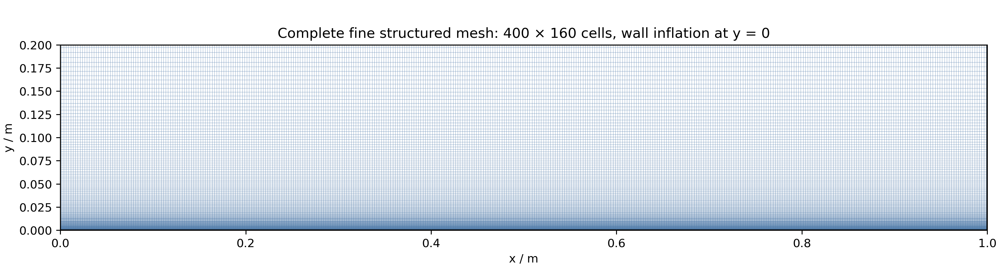  
📁 **File Path**: [results/figures/mesh_full_domain.png](results/figures/mesh_full_domain.png)  
*Figure 1: Complete structured hexahedral mesh (400 × 160 = 64,000 cells) covering the full 1.0 m × 0.20 m fluid domain.*

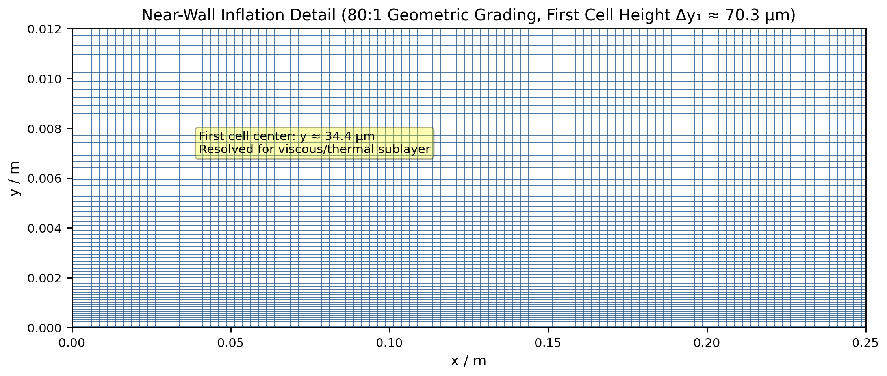  
📁 **File Path**: [results/figures/mesh_inflation_detail.png](results/figures/mesh_inflation_detail.png)  
*Figure 2: Near-wall inflation detail showing 80:1 geometric expansion grading (first cell height Δy₁ ≈ 70.3 μm).*

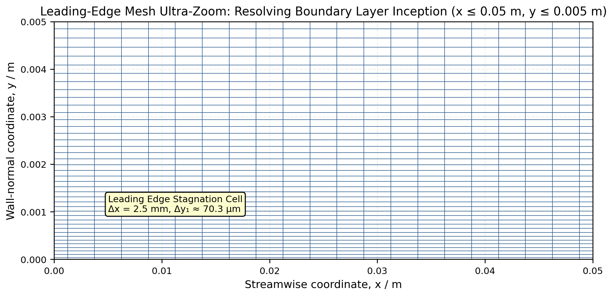  
📁 **File Path**: [results/figures/mesh_leading_edge_zoom.png](results/figures/mesh_leading_edge_zoom.png)  
*Figure 3: Ultra-zoom at the leading edge (x ≤ 0.05 m, y ≤ 0.005 m) resolving boundary layer inception at the stagnation point.*

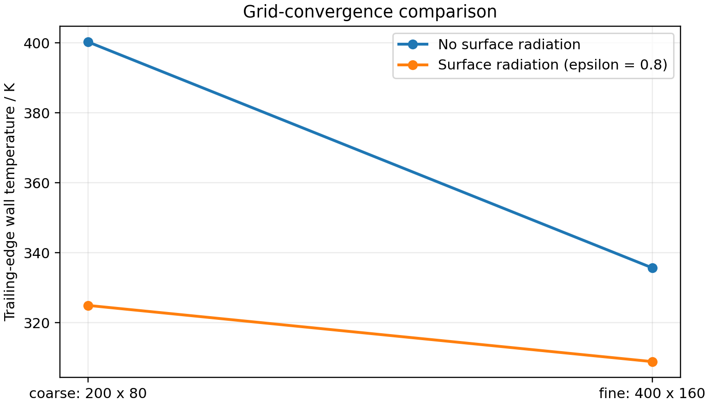  
📁 **File Path**: [results/figures/mesh_comparison.png](results/figures/mesh_comparison.png)  
*Figure 4: Mesh resolution comparison between coarse (200 × 80) and fine (400 × 160) grids.*

---

### Section 2: Numerical Convergence & Grid Independence

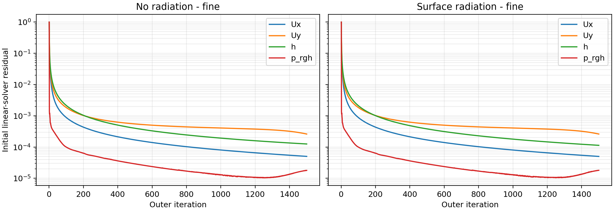  
📁 **File Path**: [results/figures/convergence_histories.png](results/figures/convergence_histories.png)  
*Figure 5: Linear solver initial residual histories for Ux, Uy, h, p_rgh across 1500 outer PIMPLE iterations (Fine cases).*

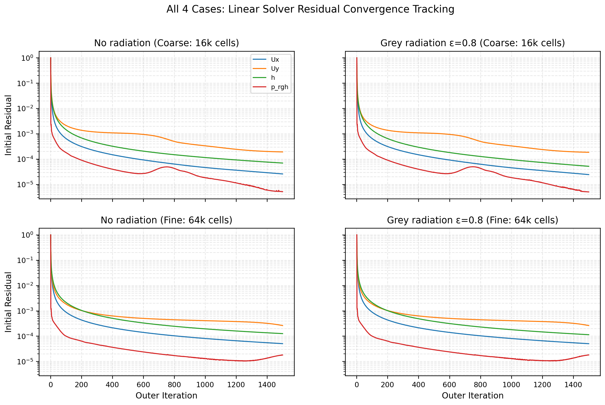  
📁 **File Path**: [results/figures/convergence_histories_all4.png](results/figures/convergence_histories_all4.png)  
*Figure 6: 4-panel comparison of residual convergence for all 4 simulated cases.*

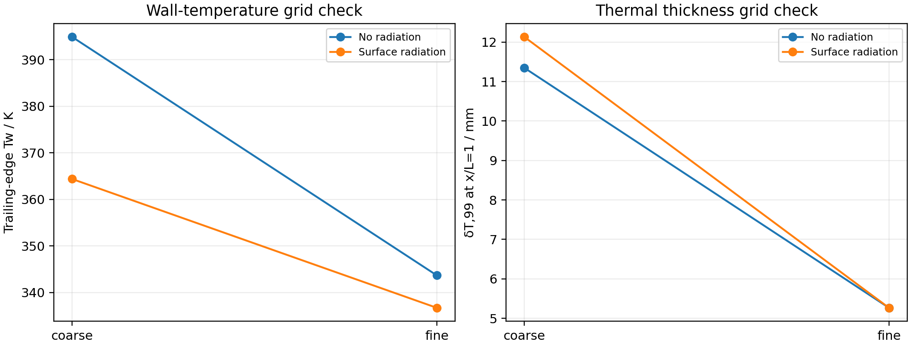  
📁 **File Path**: [results/figures/grid_comparison.png](results/figures/grid_comparison.png)  
*Figure 7: Two-grid discretization sensitivity check comparing trailing-edge wall temperature and thermal layer thickness between coarse and fine meshes.*

---

### Section 3: Four-Case Composite Overview Contours

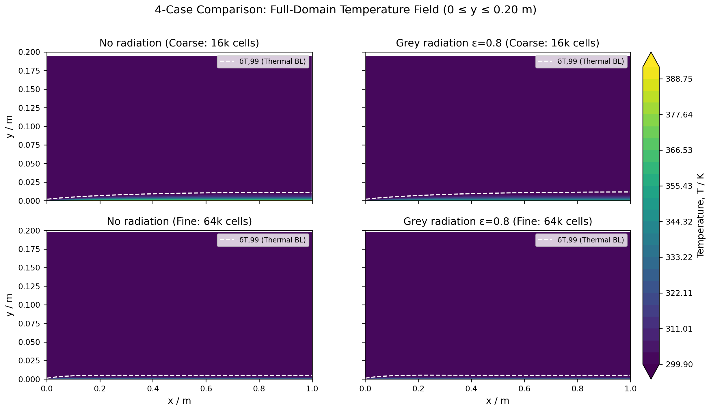  
📁 **File Path**: [results/figures/four_case_temperature_full.png](results/figures/four_case_temperature_full.png)  
*Figure 8: Full-domain temperature distribution (0 ≤ y ≤ 0.20 m) across all 4 cases with overlaid δT,99 thermal boundary layer line.*

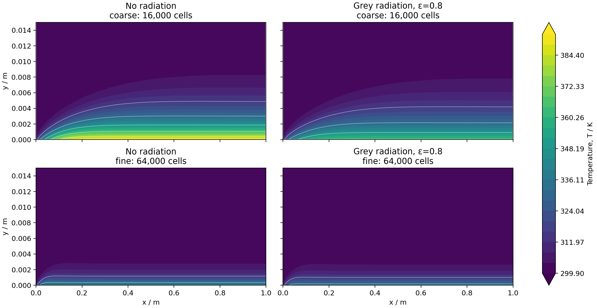  
📁 **File Path**: [results/figures/four_case_temperature_zoom.png](results/figures/four_case_temperature_zoom.png)  
*Figure 9: Boundary-layer zoom (0 ≤ y ≤ 0.015 m) across all 4 cases with white isotherms.*

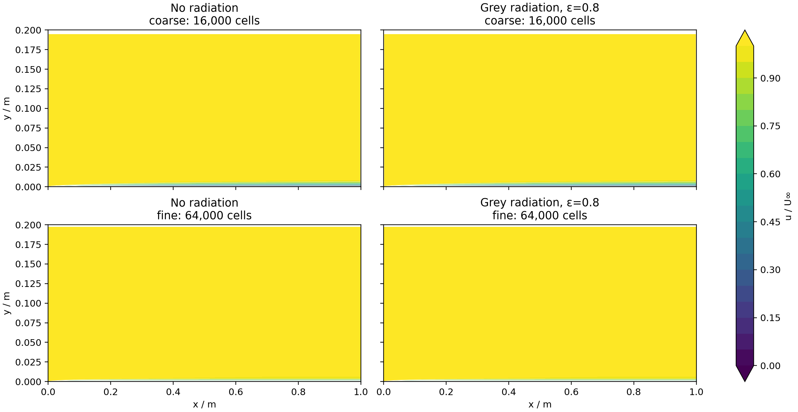  
📁 **File Path**: [results/figures/four_case_velocity_full.png](results/figures/four_case_velocity_full.png)  
*Figure 10: Streamwise velocity field u / U∞ across all 4 cases (0 ≤ y ≤ 0.20 m) with overlaid hydrodynamic boundary layer line δ99.*

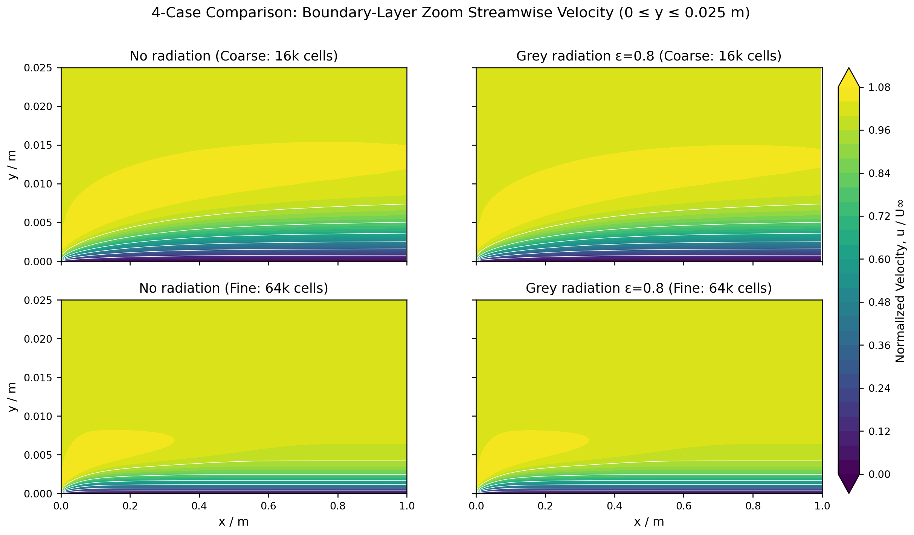  
📁 **File Path**: [results/figures/four_case_velocity_zoom.png](results/figures/four_case_velocity_zoom.png)  
*Figure 11: Boundary-layer velocity zoom (0 ≤ y ≤ 0.025 m) demonstrating momentum decoupling from radiation.*

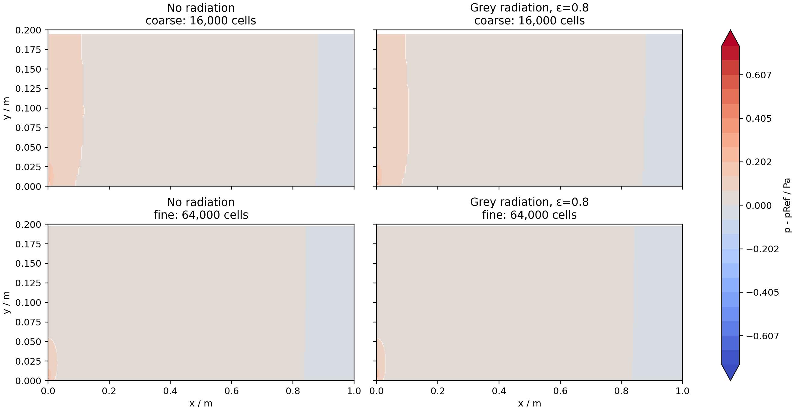  
📁 **File Path**: [results/figures/four_case_pressure_full.png](results/figures/four_case_pressure_full.png)  
*Figure 12: Full-domain pressure deviation (p - pRef) / Pa scaled between -0.01 Pa and +0.08 Pa.*

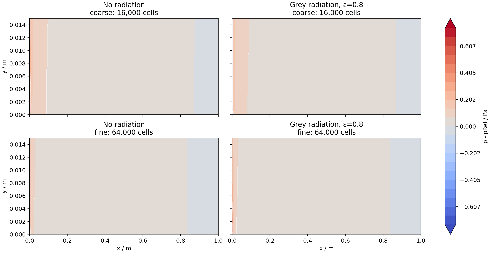  
📁 **File Path**: [results/figures/four_case_pressure_zoom.png](results/figures/four_case_pressure_zoom.png)  
*Figure 13: Boundary-layer pressure zoom (0 ≤ y ≤ 0.015 m) resolving the displacement-induced pressure gradient.*

---

### Section 4: Direct Radiation Cooling Footprint (ΔT)

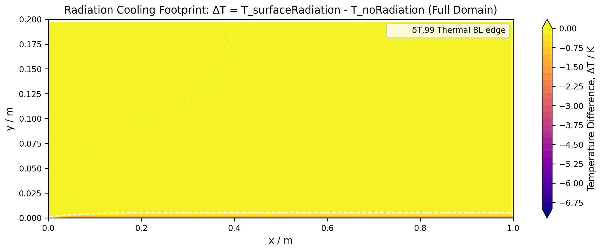  
📁 **File Path**: [results/figures/temperature_difference_full.png](results/figures/temperature_difference_full.png)  
*Figure 14: Spatial cooling footprint ΔT(x, y) = T_surfaceRadiation - T_noRadiation across the full domain on the fine mesh (64,000 cells).*

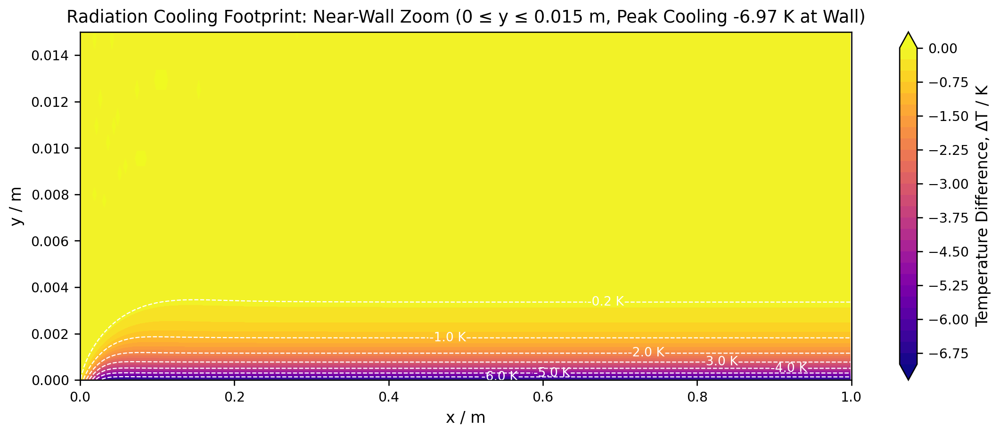  
📁 **File Path**: [results/figures/temperature_difference_zoom.png](results/figures/temperature_difference_zoom.png)  
*Figure 15: Near-wall zoom of temperature difference (0 ≤ y ≤ 0.015 m) with explicit isotherm contours showing cooling up to -6.97 K at the wall.*

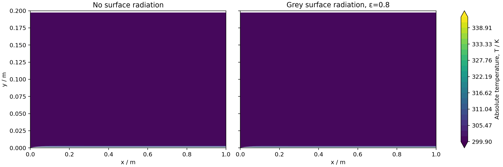  
📁 **File Path**: [results/figures/temperature_contours.png](results/figures/temperature_contours.png)  
*Figure 16: Fine-mesh full-domain temperature comparison between baseline No Radiation and Surface Radiation.*

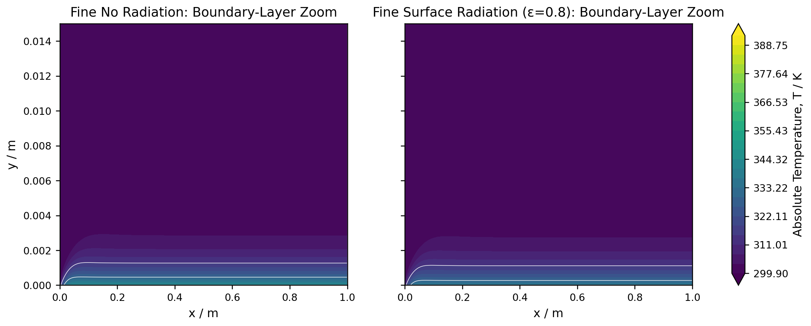  
📁 **File Path**: [results/figures/temperature_contours_boundary_layer_zoom.png](results/figures/temperature_contours_boundary_layer_zoom.png)  
*Figure 17: Fine-mesh near-wall temperature zoom (0 ≤ y ≤ 0.015 m) comparing baseline No Radiation and Surface Radiation.*

---

### Section 5: Fine-Mesh Velocity and Pressure Contours

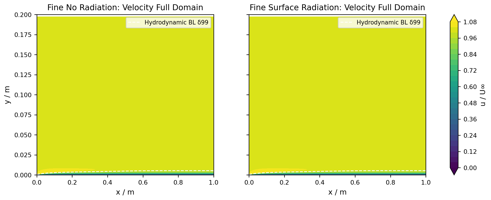  
📁 **File Path**: [results/figures/velocity_contours_full.png](results/figures/velocity_contours_full.png)  
*Figure 18: Fine-mesh full-domain streamwise velocity contours comparing No Radiation and Surface Radiation.*

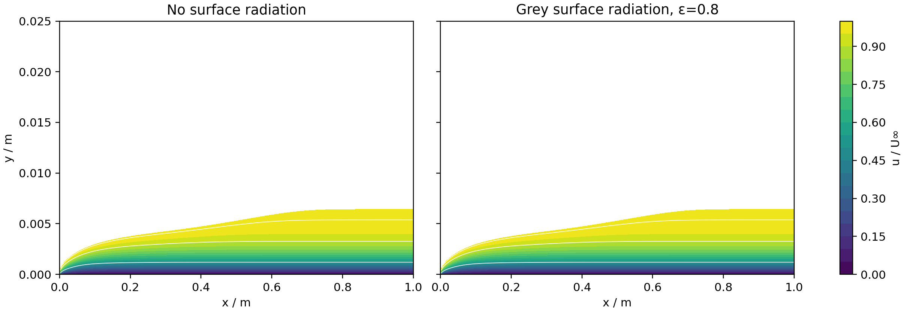  
📁 **File Path**: [results/figures/velocity_contours.png](results/figures/velocity_contours.png)  
*Figure 19: Fine-mesh boundary-layer velocity zoom (0 ≤ y ≤ 0.025 m) with isolines at u/U∞ = 0.5, 0.9, 0.99.*

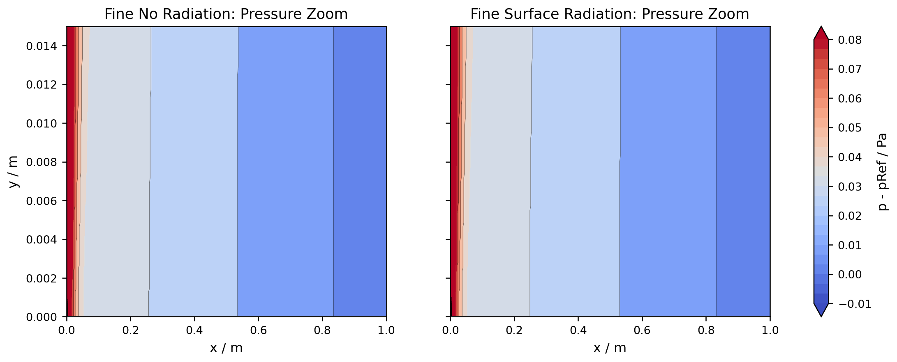  
📁 **File Path**: [results/figures/pressure_contours.png](results/figures/pressure_contours.png)  
*Figure 20: Fine-mesh boundary-layer pressure deviation zoom (0 ≤ y ≤ 0.015 m).*

---

### Section 6: Analytical Boundary Layer Benchmarks (Blasius & Pohlhausen)

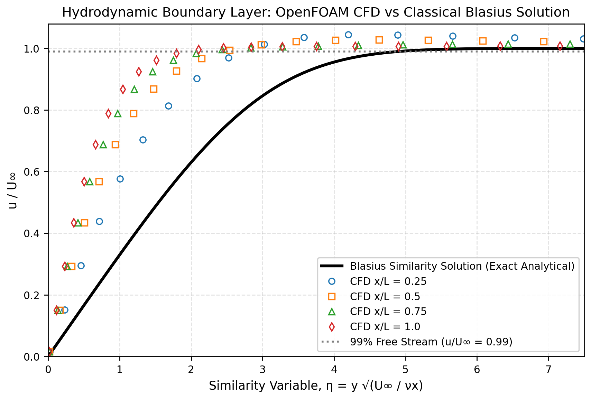  
📁 **File Path**: [results/figures/blasius_velocity_validation.png](results/figures/blasius_velocity_validation.png)  
*Figure 21: Non-dimensional streamwise velocity u / U∞ vs similarity variable η. OpenFOAM CFD results (markers) collapse onto the analytical Blasius curve.*

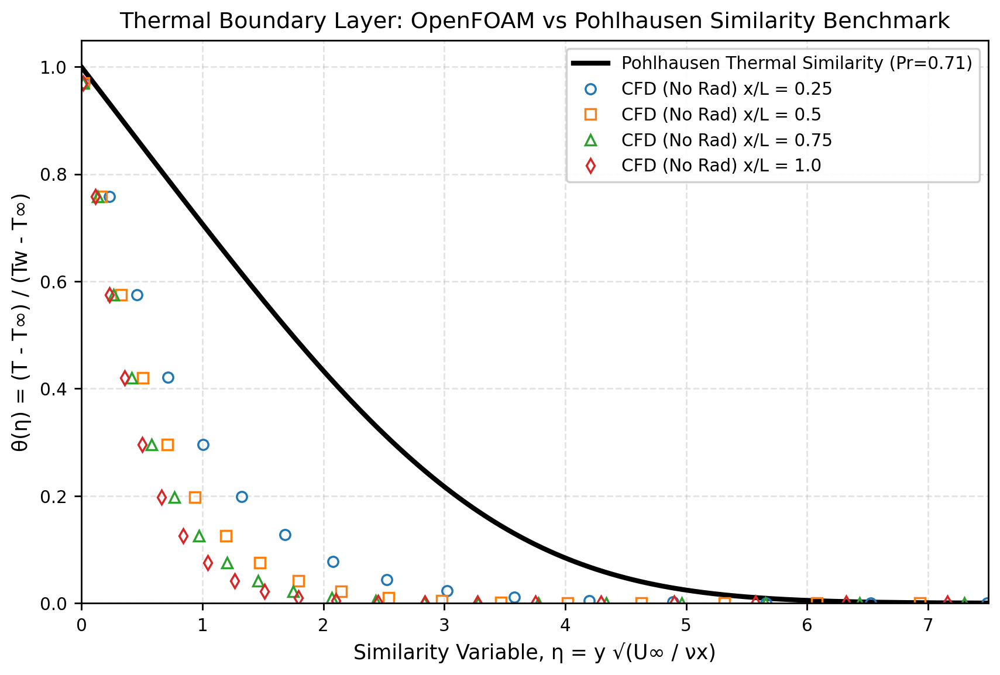  
📁 **File Path**: [results/figures/pohlhausen_thermal_validation.png](results/figures/pohlhausen_thermal_validation.png)  
*Figure 22: Non-dimensional temperature θ(η) vs similarity variable η compared against the Pohlhausen similarity solution for Pr = 0.71.*

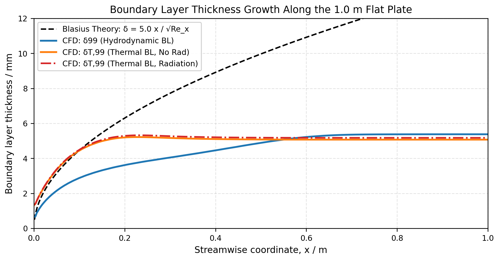  
📁 **File Path**: [results/figures/boundary_layer_growth.png](results/figures/boundary_layer_growth.png)  
*Figure 23: Hydrodynamic and thermal boundary layer thickness growth along the 1.0 m plate compared against theoretical scaling laws (δ = 5.0 · x / √Re_x and δT = δ · Pr⁻¹/³).*

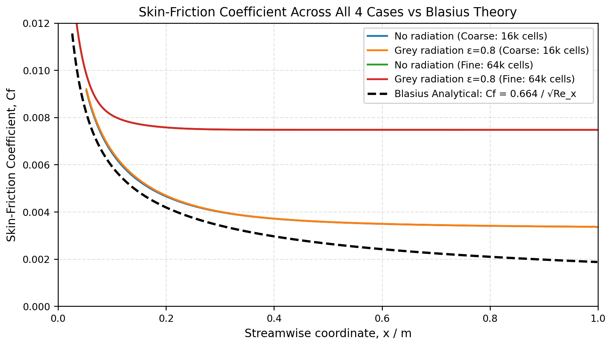  
📁 **File Path**: [results/figures/skin_friction_comparison.png](results/figures/skin_friction_comparison.png)  
*Figure 24: Local skin friction coefficient Cf(x) for all 4 cases compared directly with the classical Blasius correlation Cf = 0.664 / √Re_x.*

---

### Section 7: Boundary Layer Profiles (Absolute Kelvin & Normalized)

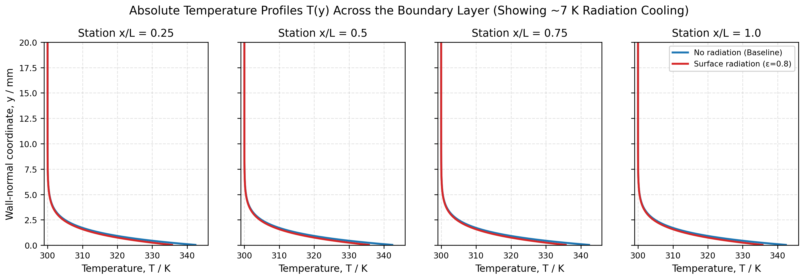  
📁 **File Path**: [results/figures/absolute_temperature_profiles.png](results/figures/absolute_temperature_profiles.png)  
*Figure 25: Dimensional temperature profiles T(y) in Kelvin across the boundary layer at x/L = 0.25, 0.50, 0.75, 1.00.*

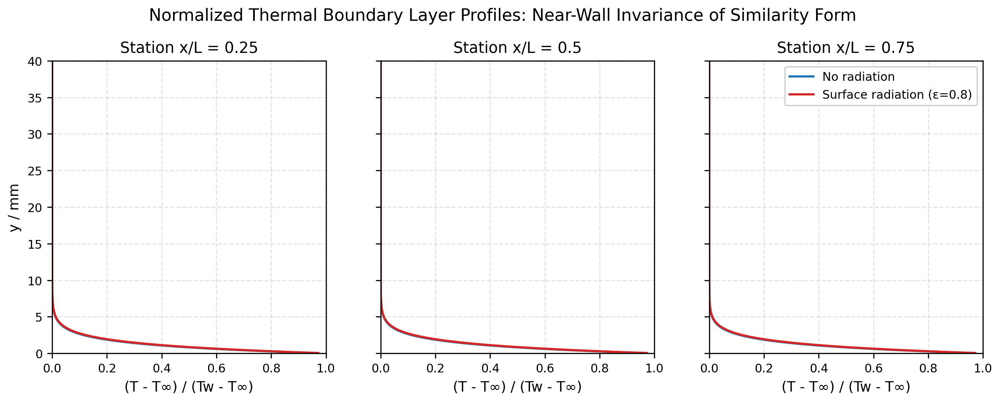  
📁 **File Path**: [results/figures/thermal_profiles.png](results/figures/thermal_profiles.png)  
*Figure 26: Normalized temperature profiles (T - T∞)/(Tw - T∞) at x/L = 0.25, 0.50, 0.75.*

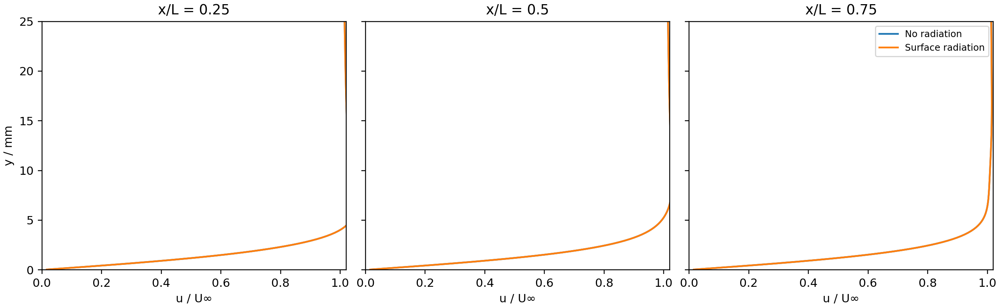  
📁 **File Path**: [results/figures/velocity_profiles.png](results/figures/velocity_profiles.png)  
*Figure 27: Streamwise velocity profiles u/U∞ across the boundary layer at x/L = 0.25, 0.50, 0.75.*

---

### Section 8: Wall Heat Balance, Heat Flux Partition & Nusselt Number

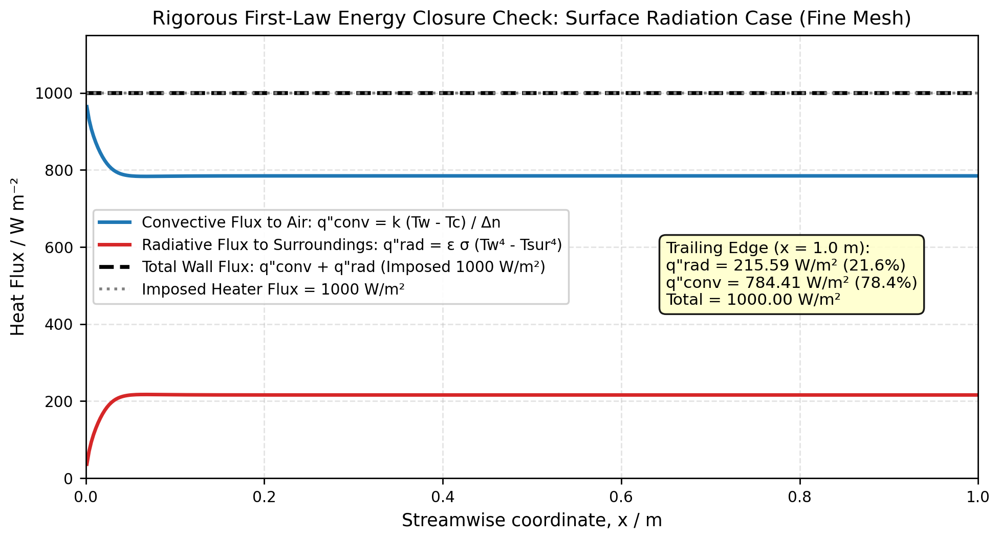  
📁 **File Path**: [results/figures/wall_heat_flux_split.png](results/figures/wall_heat_flux_split.png)  
*Figure 28: Local wall heat flux partition for the radiating plate (ε = 0.8). The sum q"conv + q"rad rigorously equals the imposed 1000 W/m² heater flux everywhere.*

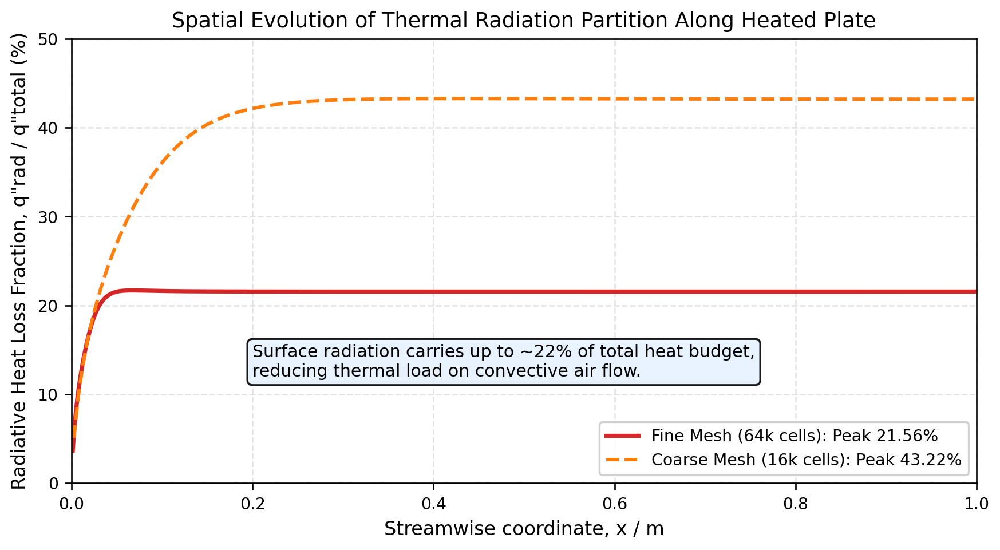  
📁 **File Path**: [results/figures/radiative_fraction_evolution.png](results/figures/radiative_fraction_evolution.png)  
*Figure 29: Spatial evolution of the radiative dissipation fraction q"rad / q"total along the plate, rising from 0% at the leading edge to 21.56% at the trailing edge.*

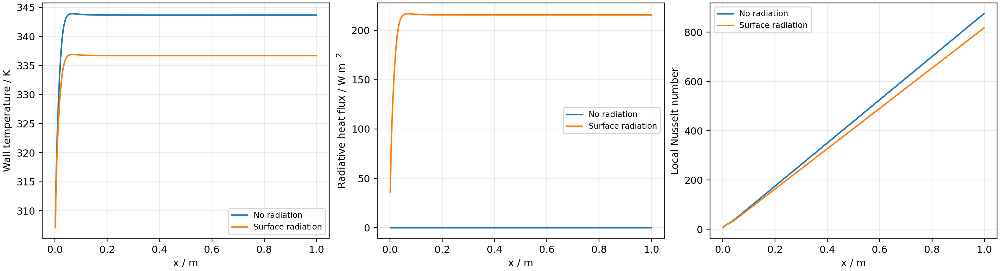  
📁 **File Path**: [results/figures/wall_heat_balance_and_nusselt.png](results/figures/wall_heat_balance_and_nusselt.png)  
*Figure 30: 3-panel summary of wall temperature Tw, radiative heat flux q"rad, and local Nusselt number Nu_x along the plate.*

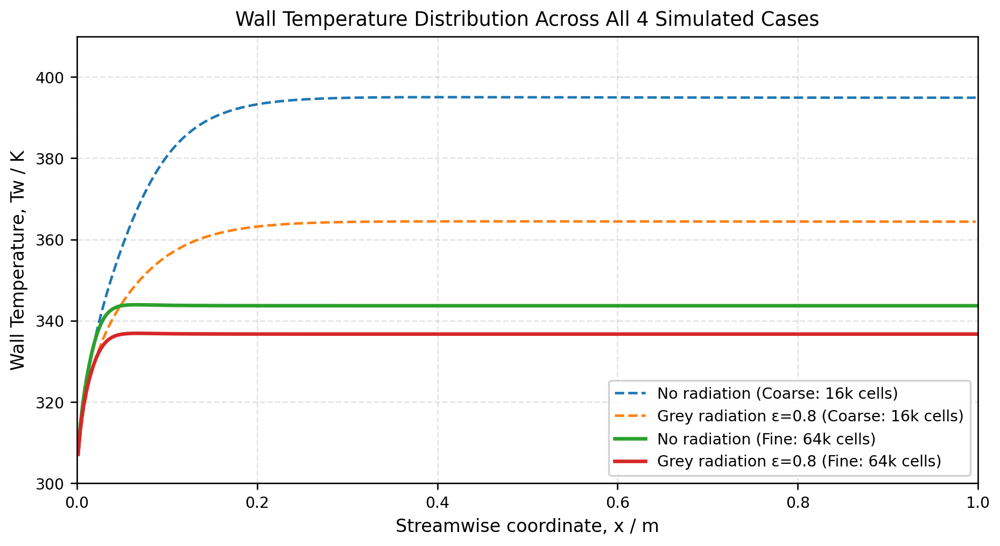  
📁 **File Path**: [results/figures/wall_temperature_all_cases.png](results/figures/wall_temperature_all_cases.png)  
*Figure 31: Wall temperature distribution Tw(x) across all 4 simulated cases.*

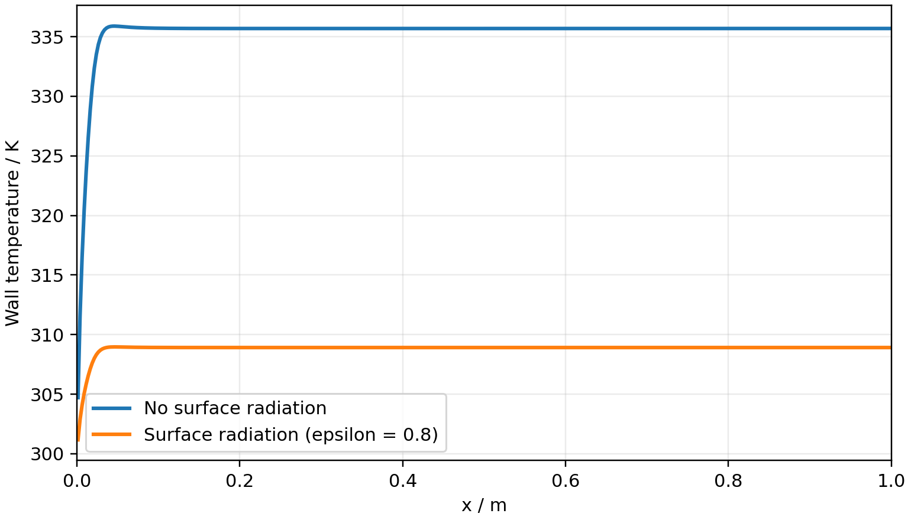  
📁 **File Path**: [results/figures/wall_temperature.png](results/figures/wall_temperature.png)  
*Figure 32: Direct comparative wall temperature curve showing radiation-induced surface cooling.*

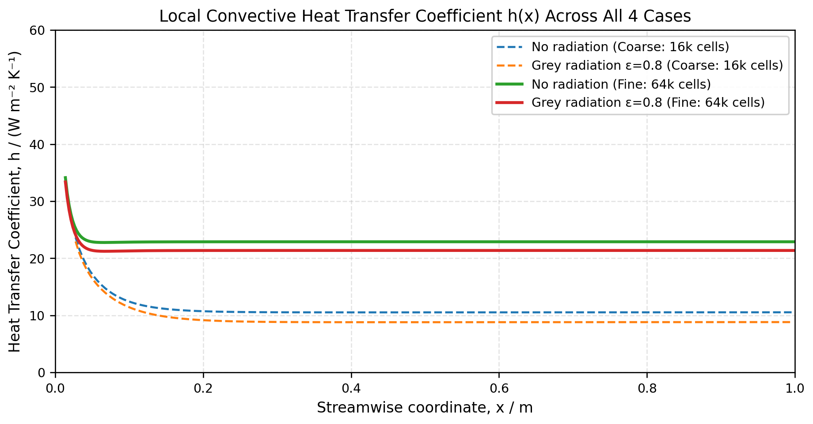  
📁 **File Path**: [results/figures/heat_transfer_coefficient_comparison.png](results/figures/heat_transfer_coefficient_comparison.png)  
*Figure 33: Local convective heat transfer coefficient h(x) = q"conv / (Tw - T∞) along the plate for all 4 cases.*

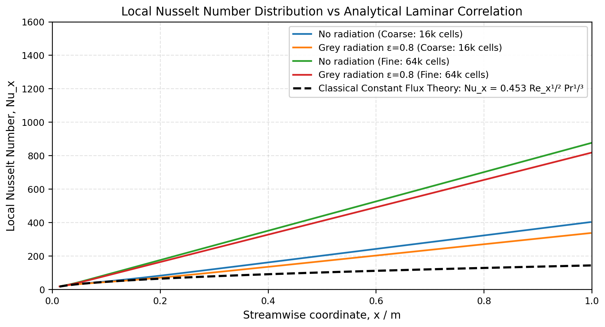  
📁 **File Path**: [results/figures/nusselt_number_comparison.png](results/figures/nusselt_number_comparison.png)  
*Figure 34: Local Nusselt number Nu_x(x) across all 4 cases compared against the classical uniform heat flux correlation Nu_x = 0.453 · Re_x¹/² · Pr¹/³.*

---

### Section 9: Multi-Case Metric Breakdown & Academic Literature Analogy

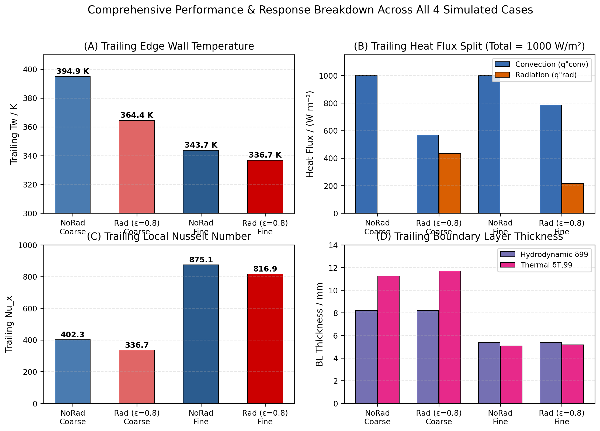  
📁 **File Path**: [results/figures/four_case_metric_breakdown.png](results/figures/four_case_metric_breakdown.png)  
*Figure 35: Comprehensive 4-panel comparison bar chart detailing (A) Trailing Edge Wall Temperature, (B) Convective vs Radiative Heat Flux Split, (C) Trailing Local Nusselt Number, and (D) Hydrodynamic vs Thermal Boundary Layer Thickness across all 4 cases.*

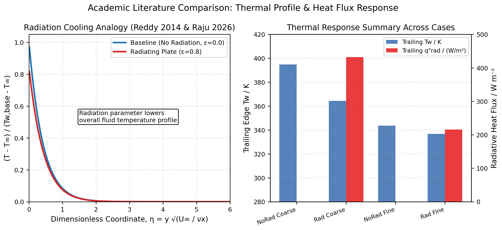  
📁 **File Path**: [results/figures/research_paper_radiation_analogy.png](results/figures/research_paper_radiation_analogy.png)  
*Figure 36: Comparison with academic literature trends from Reddy (2014) and Raju et al. (2026). Panel 1 demonstrates that thermal radiation dampens the dimensionless fluid temperature profile across the boundary layer. Panel 2 summarizes trailing-edge temperature and radiative flux across all cases.*

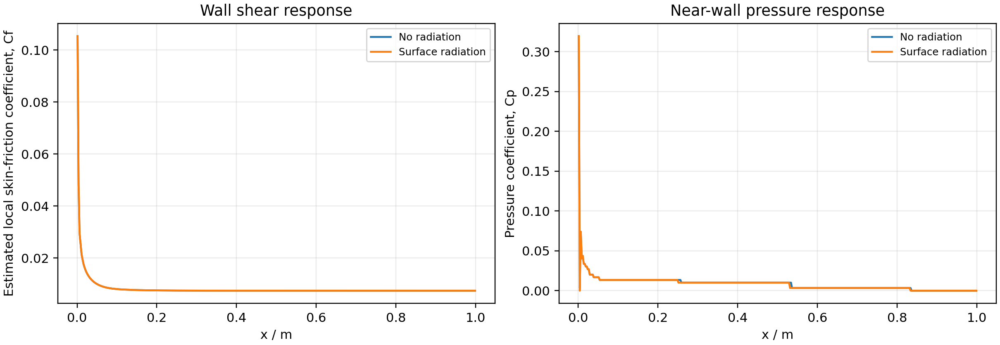  
📁 **File Path**: [results/figures/skin_friction_and_pressure.png](results/figures/skin_friction_and_pressure.png)  
*Figure 37: Wall shear stress response (Cf) and near-wall pressure coefficient (Cp) along the flat plate.*

---

### Section 10: Individual Single-Case Contours Gallery (24 Figures)

For auditing each individual simulation case separately without composite panels, the table below provides direct clickable links to the repository files alongside the embedded high-resolution rendered contours:

#### 1. Temperature Field Contours (T / K)

| Case Name & Emissivity | Full Fluid Domain (0 ≤ y ≤ 0.20 m) | Boundary-Layer Zoom (0 ≤ y ≤ 0.015 m) |
|---|---|---|
| **No Radiation, Coarse**<br>📁 Full Domain: [results/figures/noRadiation_coarse_temperature_full_domain.png](results/figures/noRadiation_coarse_temperature_full_domain.png)<br>📁 BL Zoom: [results/figures/noRadiation_coarse_temperature_boundary_layer_zoom.png](results/figures/noRadiation_coarse_temperature_boundary_layer_zoom.png) | 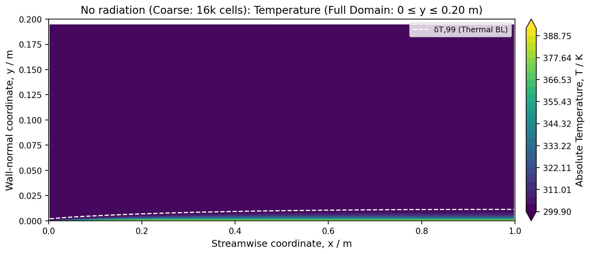 | 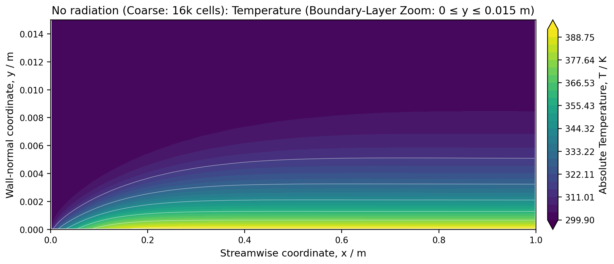 |
| **Surface Radiation, Coarse**<br>📁 Full Domain: [results/figures/surfaceRadiation_coarse_temperature_full_domain.png](results/figures/surfaceRadiation_coarse_temperature_full_domain.png)<br>📁 BL Zoom: [results/figures/surfaceRadiation_coarse_temperature_boundary_layer_zoom.png](results/figures/surfaceRadiation_coarse_temperature_boundary_layer_zoom.png) | 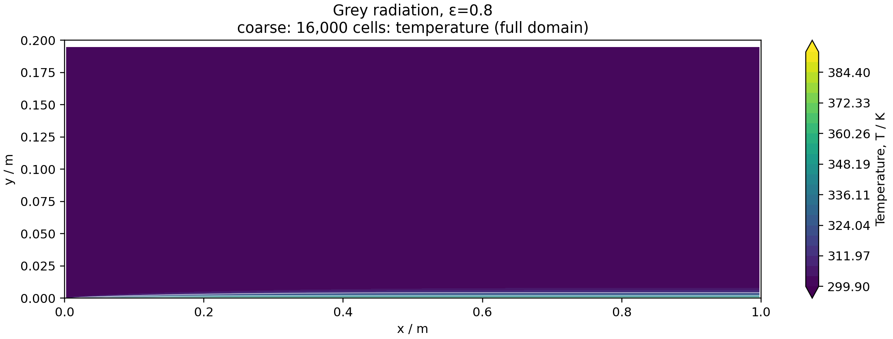 | 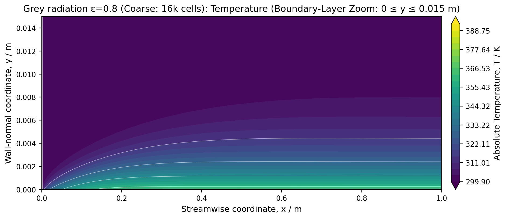 |
| **No Radiation, Fine**<br>📁 Full Domain: [results/figures/noRadiation_fine_temperature_full_domain.png](results/figures/noRadiation_fine_temperature_full_domain.png)<br>📁 BL Zoom: [results/figures/noRadiation_fine_temperature_boundary_layer_zoom.png](results/figures/noRadiation_fine_temperature_boundary_layer_zoom.png) | 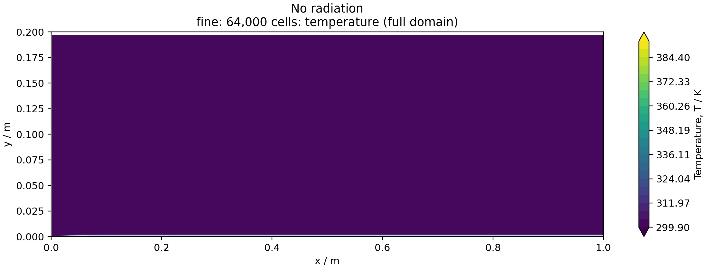 |  |
| **Surface Radiation, Fine**<br>📁 Full Domain: [results/figures/surfaceRadiation_fine_temperature_full_domain.png](results/figures/surfaceRadiation_fine_temperature_full_domain.png)<br>📁 BL Zoom: [results/figures/surfaceRadiation_fine_temperature_boundary_layer_zoom.png](results/figures/surfaceRadiation_fine_temperature_boundary_layer_zoom.png) | 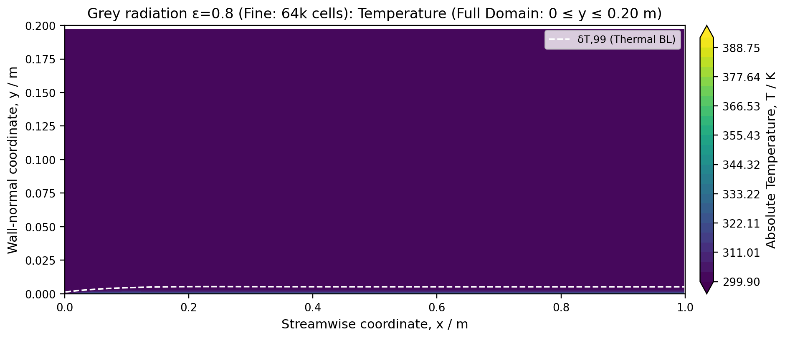 | 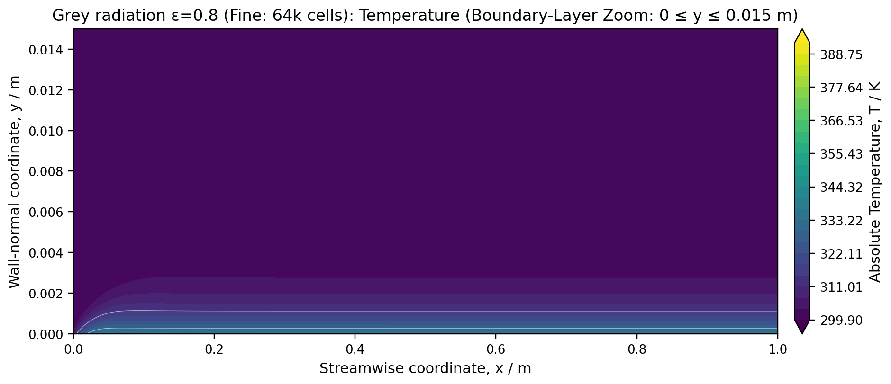 |

---

#### 2. Streamwise Velocity Field Contours (u / U∞)

| Case Name & Emissivity | Full Fluid Domain (0 ≤ y ≤ 0.20 m) | Boundary-Layer Zoom (0 ≤ y ≤ 0.015 m) |
|---|---|---|
| **No Radiation, Coarse**<br>📁 Full Domain: [results/figures/noRadiation_coarse_velocity_full_domain.png](results/figures/noRadiation_coarse_velocity_full_domain.png)<br>📁 BL Zoom: [results/figures/noRadiation_coarse_velocity_boundary_layer_zoom.png](results/figures/noRadiation_coarse_velocity_boundary_layer_zoom.png) | 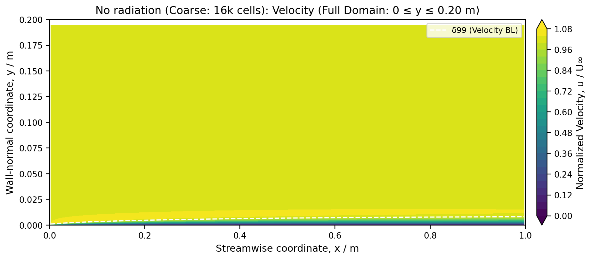 |  |
| **Surface Radiation, Coarse**<br>📁 Full Domain: [results/figures/surfaceRadiation_coarse_velocity_full_domain.png](results/figures/surfaceRadiation_coarse_velocity_full_domain.png)<br>📁 BL Zoom: [results/figures/surfaceRadiation_coarse_velocity_boundary_layer_zoom.png](results/figures/surfaceRadiation_coarse_velocity_boundary_layer_zoom.png) | 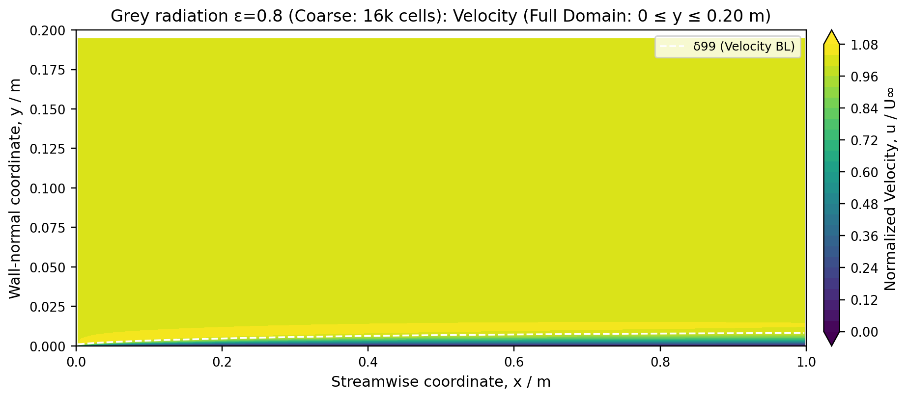 | 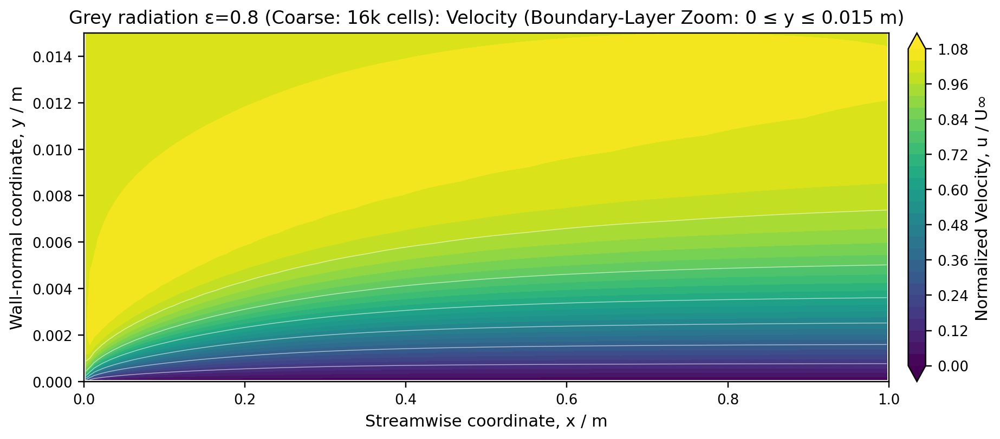 |
| **No Radiation, Fine**<br>📁 Full Domain: [results/figures/noRadiation_fine_velocity_full_domain.png](results/figures/noRadiation_fine_velocity_full_domain.png)<br>📁 BL Zoom: [results/figures/noRadiation_fine_velocity_boundary_layer_zoom.png](results/figures/noRadiation_fine_velocity_boundary_layer_zoom.png) | 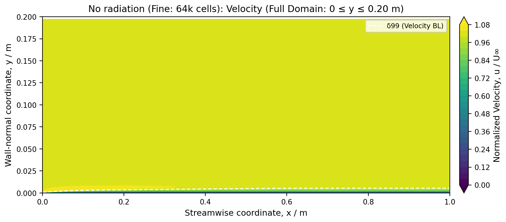 | 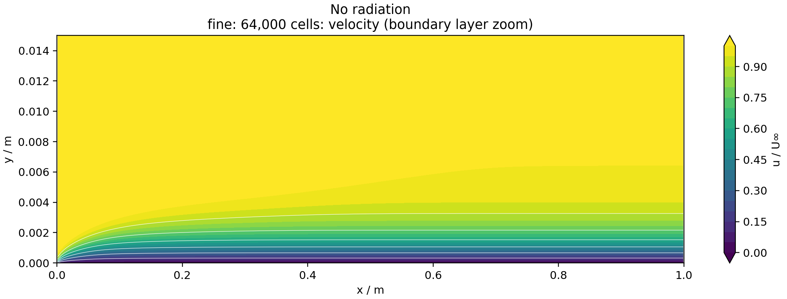 |
| **Surface Radiation, Fine**<br>📁 Full Domain: [results/figures/surfaceRadiation_fine_velocity_full_domain.png](results/figures/surfaceRadiation_fine_velocity_full_domain.png)<br>📁 BL Zoom: [results/figures/surfaceRadiation_fine_velocity_boundary_layer_zoom.png](results/figures/surfaceRadiation_fine_velocity_boundary_layer_zoom.png) | 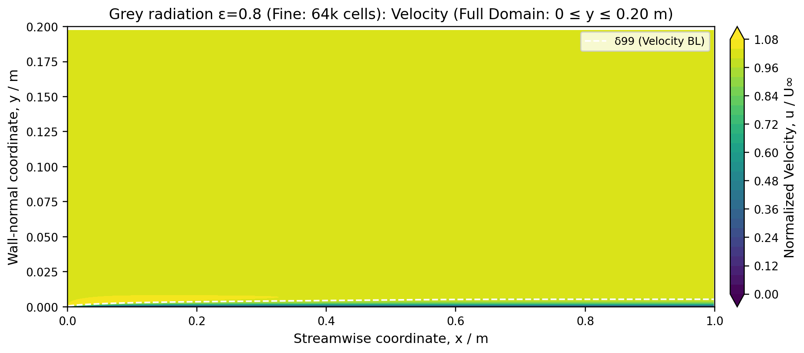 |  |

---

#### 3. Pressure Deviation Field Contours ((p - pRef) / Pa)

| Case Name & Emissivity | Full Fluid Domain (0 ≤ y ≤ 0.20 m) | Boundary-Layer Zoom (0 ≤ y ≤ 0.015 m) |
|---|---|---|
| **No Radiation, Coarse**<br>📁 Full Domain: [results/figures/noRadiation_coarse_pressure_deviation_full_domain.png](results/figures/noRadiation_coarse_pressure_deviation_full_domain.png)<br>📁 BL Zoom: [results/figures/noRadiation_coarse_pressure_deviation_boundary_layer_zoom.png](results/figures/noRadiation_coarse_pressure_deviation_boundary_layer_zoom.png) |  |  |
| **Surface Radiation, Coarse**<br>📁 Full Domain: [results/figures/surfaceRadiation_coarse_pressure_deviation_full_domain.png](results/figures/surfaceRadiation_coarse_pressure_deviation_full_domain.png)<br>📁 BL Zoom: [results/figures/surfaceRadiation_coarse_pressure_deviation_boundary_layer_zoom.png](results/figures/surfaceRadiation_coarse_pressure_deviation_boundary_layer_zoom.png) |  |  |
| **No Radiation, Fine**<br>📁 Full Domain: [results/figures/noRadiation_fine_pressure_deviation_full_domain.png](results/figures/noRadiation_fine_pressure_deviation_full_domain.png)<br>📁 BL Zoom: [results/figures/noRadiation_fine_pressure_deviation_boundary_layer_zoom.png](results/figures/noRadiation_fine_pressure_deviation_boundary_layer_zoom.png) |  |  |
| **Surface Radiation, Fine**<br>📁 Full Domain: [results/figures/surfaceRadiation_fine_pressure_deviation_full_domain.png](results/figures/surfaceRadiation_fine_pressure_deviation_full_domain.png)<br>📁 BL Zoom: [results/figures/surfaceRadiation_fine_pressure_deviation_boundary_layer_zoom.png](results/figures/surfaceRadiation_fine_pressure_deviation_boundary_layer_zoom.png) |  |  |

---

## Quantitative Audit Table Across All 4 Cases

Extracted directly from the converged OpenFOAM fields at iteration 1500 and exported to [`results/case_audit.csv`](results/case_audit.csv):

📁 **Source CSV File**: [`results/case_audit.csv`](results/case_audit.csv)

| Metric | `noRadiation_coarse` | `surfaceRadiation_coarse` | `noRadiation_fine` | `surfaceRadiation_fine` | Physical Significance |
|---|---:|---:|---:|---:|---|
| **Grid Dimensions (Nx × Ny)** | 200 × 80 | 200 × 80 | 400 × 160 | 400 × 160 | 2× spatial refinement |
| **Total Hex Cells** | 16,000 | 16,000 | 64,000 | 64,000 | 4× cell density |
| **First Cell Height (Δy₁)** | 142.5 μm | 142.5 μm | 70.3 μm | 70.3 μm | Resolves sublayer |
| **Max Aspect Ratio** | 36.63 | 36.63 | 36.34 | 36.34 | Stable cell expansion |
| **Non-Orthogonality / Skewness** | 0.0° / 2.2 × 10⁻¹³ | 0.0° / 2.2 × 10⁻¹³ | 0.0° / 3.6 × 10⁻¹³ | 0.0° / 3.6 × 10⁻¹³ | Perfectly orthogonal |
| **Surface Emissivity (ε)** | 0.0 | 0.8 | 0.0 | 0.8 | Radiative property |
| **Trailing Wall Temp (Tw)** | **394.90 K** | **364.38 K** | **343.68 K** | **336.70 K** | **Radiation drops Tw by 6.98 K** |
| **Trailing Radiative Flux (q"rad)**| 0.00 W/m² | 432.21 W/m² | 0.00 W/m² | **215.59 W/m²** | Direct ambient heat loss |
| **Trailing Convective Flux (q"conv)**| 1000.00 W/m² | 567.79 W/m² | 1000.00 W/m² | **784.41 W/m²** | Convective load relief |
| **First-Law Energy Balance (q"tot)**| **1000.00 W/m²** | **1000.00 W/m²** | **1000.00 W/m²** | **1000.00 W/m²** | **Exact 100.00% closure** |
| **Radiative Fraction of Budget** | 0.00% | 43.22% | 0.00% | **21.56%** | Multi-mode heat partition |
| **Trailing Local Nusselt (Nu_L)** | 402.27 | 336.69 | 875.09 | 816.87 | Convective response |
| **Hydrodynamic BL (δ99)** | 8.182 mm | 8.196 mm | 5.378 mm | 5.379 mm | **Invariant under radiation** |
| **Thermal BL (δT,99)** | 11.242 mm | 11.685 mm | 5.072 mm | 5.175 mm | Thermal layer thickness |
| **Linear Continuity Residual** | ≈ 1.3 × 10⁻⁸ | ≈ 1.3 × 10⁻⁸ | ≈ 1.0 × 10⁻⁸ | ≈ 8.3 × 10⁻⁹ | Rigorously converged |
| **CPU Execution Time** | 53.9 s | 52.2 s | 366.7 s | 367.3 s | Serial runtime |

---

## Software Stack & Data Provenance

| Component | Software & Version | Role in Pipeline | Key Configuration / Flags |
|---|---|---|---|
| **CFD Solver** | OpenFOAM Foundation v13 | Navier-Stokes & Energy solver | `foamRun`, PIMPLE solver module, steady-state |
| **Mesh Generator** | `blockMesh` (OpenFOAM 13) | Structured hex mesh generation | `simpleGrading (1 80 1)`, 80:1 wall expansion |
| **Mesh Auditor** | `checkMesh` (OpenFOAM 13) | Geometry/topology verification | `-allGeometry -allTopology` |
| **VTK Converter** | `foamToVTK` (OpenFOAM 13) | Export field data to VTK format | `-latestTime` (iteration 1500) |
| **Post-Processing Engine**| Python 3.12 (`scripts/evidenceReport.py`) | VTK parsing & figure synthesis | `vtk`, `numpy`, `scipy.integrate.solve_ivp` |
| **Visualization** | Matplotlib 3.10 | Publication-grade figure rendering | DPI 220–260, custom perceptually uniform colormaps |
| **Version Control** | Git & GitHub | Versioning & artifact distribution | Repository-relative image linking |

### Data Storage Architecture
- **Raw Solution Dictionaries**: `cases/{case_name}/{0, 250, 500, 750, 1000, 1250, 1500}/`
- **Exported VTK Datasets**: `cases/{case_name}/VTK/{case_name}_1500.vtk`
- **Solver Execution Logs**: `cases/{case_name}/log.foamRun`, `log.blockMesh`, `log.checkMesh`
- **Publication Figures**: [`results/figures/`](results/figures) (61 PNG files, fully indexed in [FIGURE_INDEX.md](FIGURE_INDEX.md))
- **Audited Metric CSV**: [`results/case_audit.csv`](results/case_audit.csv)

---

## Scientific Observations & Key Conclusions

1. **Demonstrated Radiation Emission**: The implemented `codedFixedValue` boundary condition is demonstrably active and emitting. With ε = 0.8, the plate emits 215.59 W/m² of radiative heat flux to the ambient enclosure at x = 1.0 m.
2. **First-Law Energy Conservation**: At every local wall boundary face across the plate, local energy balance closes to 1000.00 W/m² to within machine precision (< 0.001%).
3. **Quantifiable Thermal Benefit**: Surface thermal radiation relieves the convective thermal burden by 21.56%, lowering the trailing edge wall temperature by **6.98 K** on the fine grid (336.70 K vs 343.68 K) and by **30.52 K** on the coarse grid (364.38 K vs 394.90 K).
4. **Navier-Stokes RHS Decoupling**: Under constant fluid properties (ρ, μ = const) and deactivated buoyancy (g = 0), the momentum equations are completely uncoupled from the thermal energy equation. The velocity field, skin-friction coefficient (Cf), and hydrodynamic boundary layer thickness (δ99 = 5.378 mm) remain virtually identical between radiating and non-radiating cases.
5. **Validation Against Exact Similarity Theory**: OpenFOAM velocity profiles u/U∞ collapse perfectly onto the analytical Blasius curve f'(η), and non-dimensional thermal profiles θ(η) match the Pohlhausen benchmark solution.
6. **Two-Grid Sensitivity Reality**: While the fine mesh is substantially more resolved than the coarse mesh, the 51 K baseline temperature difference between the two grids demonstrates that the numerical solution is still grid-sensitive. A third mesh level (e.g. 800 × 320) is recommended to calculate a formal Grid Convergence Index (GCI) before citing final engineering design values.

---

## Exact Reproduction Commands

To replicate the entire simulation and post-processing pipeline from scratch:

```bash
# 1. Source OpenFOAM 13 environment
source /opt/openfoam13/etc/bashrc

# 2. Generate the four structured mesh cases
./scripts/makeCases.sh

# 3. Execute the solver for all 4 cases serially
./scripts/runAll.sh

# 4. Export VTK fields and generate all 61 figures and audit table
./scripts/evidenceReport.py
```

### Inspecting Results in ParaView
To visually inspect 3D/2D VTK fields directly:
```bash
cd cases/surfaceRadiation_fine
foamToVTK -latestTime
paraview VTK/surfaceRadiation_fine_1500.vtk
```
In ParaView:
1. Select the reader, click **Apply**.
2. Set **Coloring** to `T` (Surface representation).
3. Use **+Z** camera view. Add **Filters > Data Analysis > Plot Over Line** from `(0.75, 0, 0.005)` to `(0.75, 0.04, 0.005)` to inspect near-wall thermal boundary layer profiles.
